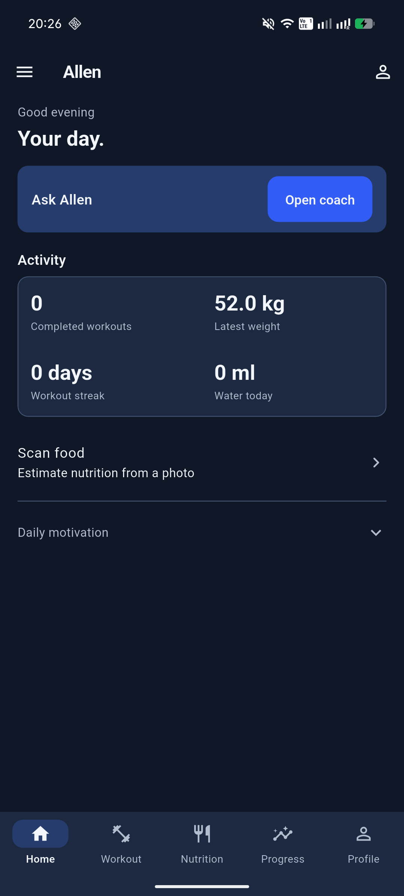
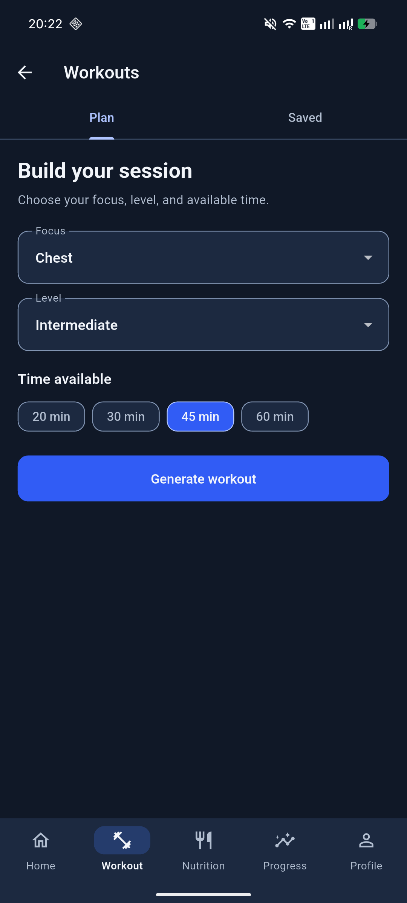
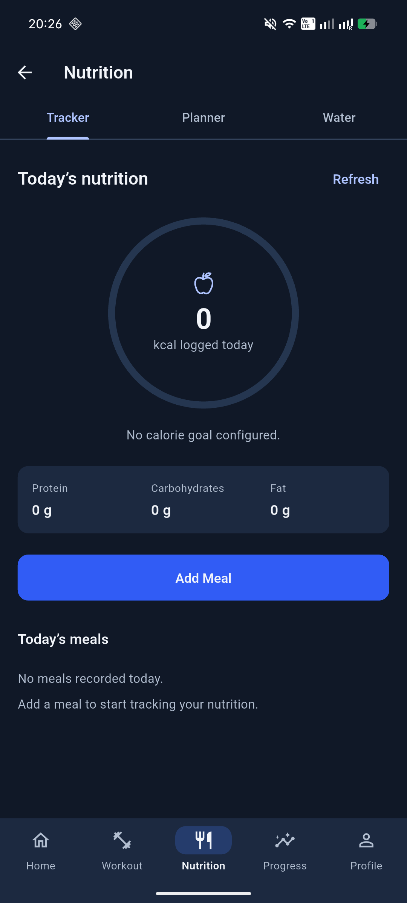
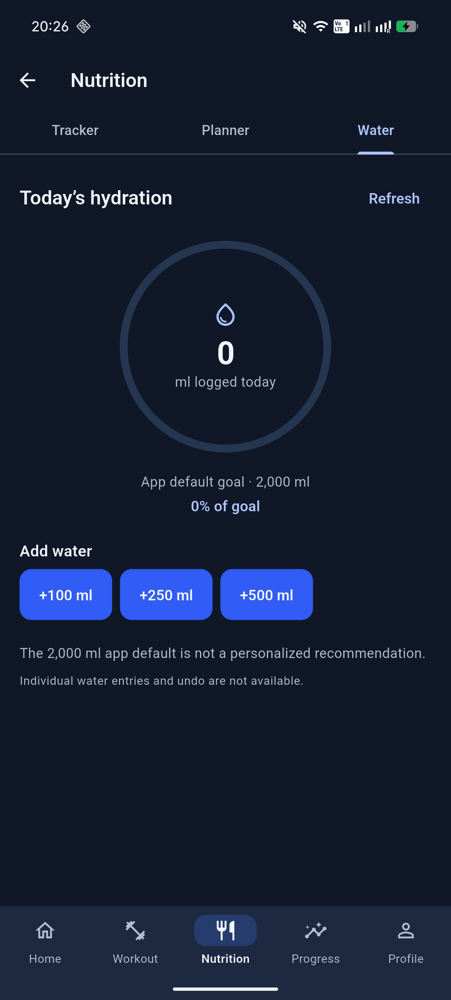
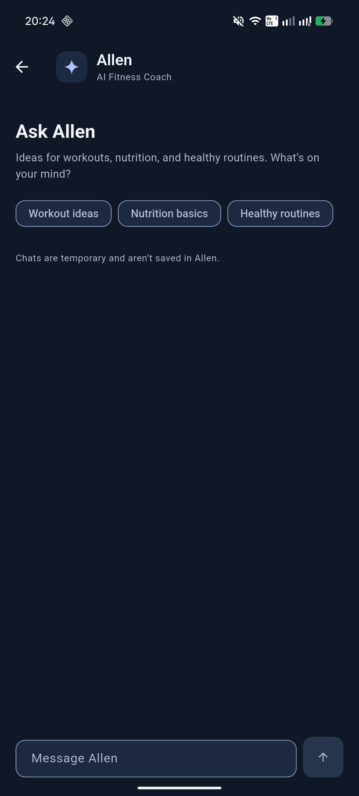
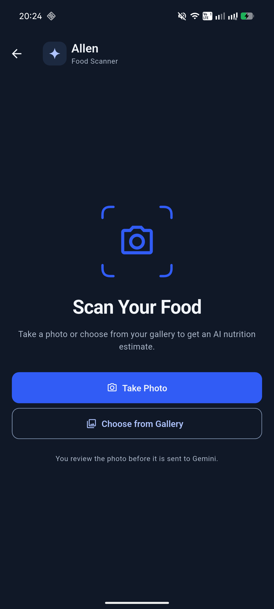
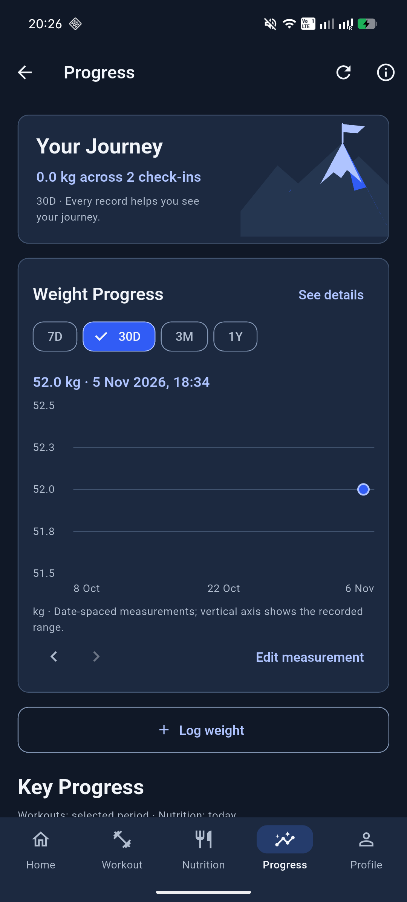
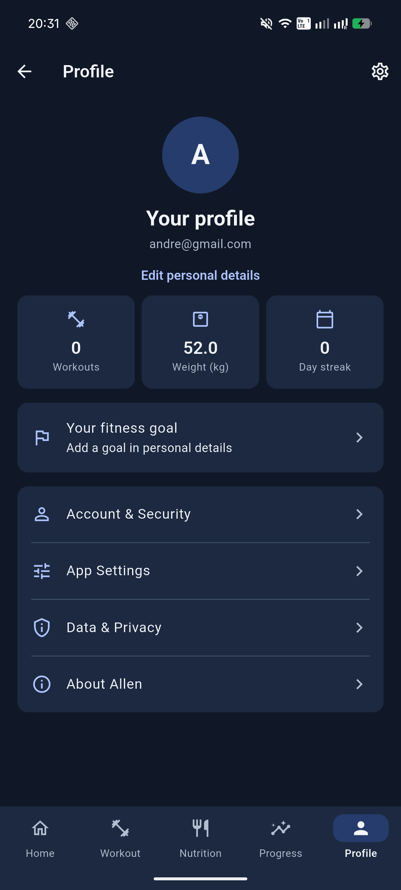
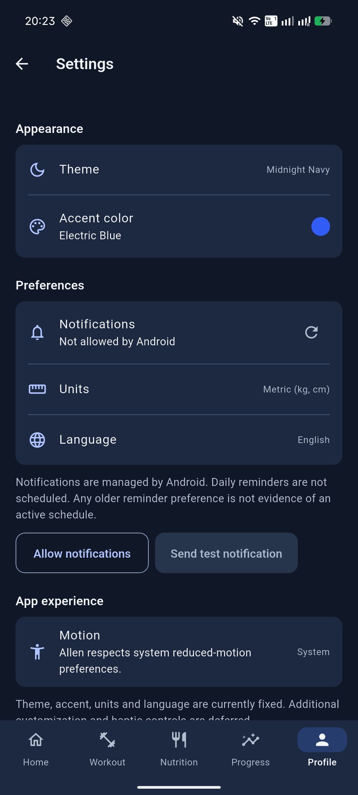

# Allen — AI Fitness Coach

Allen is a Flutter fitness app for planning workouts, tracking nutrition and weight, and getting AI-powered guidance. It combines Firebase Authentication, Google Gemini integration, local persistence, and a consistent Midnight Navy + Electric Blue interface.

## App screenshots

Real Android screenshots captured from Allen with test-account data.

<p align="center">
  
  
  
</p>
<p align="center">
  
  
  
</p>
<p align="center">
  
  
  
</p>

## Key features

- **Workouts:** Gemini-generated plans, saved workouts, and completion tracking.
- **Nutrition:** Meal suggestions, reviewed meal logging, daily summaries, and water tracking.
- **Food Scanner:** Camera/gallery input, Gemini nutrition estimates, editing, and confirmed saving to Nutrition.
- **AI Coach:** Temporary chat with bounded context, loading feedback, safe errors, and retry.
- **Progress:** Interactive weight charts, date filters, weight logging/editing, and an activity timeline.
- **Account:** Firebase registration, sign-in, password reset, session restoration, profile editing, and local JSON export.
- **Navigation:** Home, Workout, Nutrition, Progress, and Profile destinations.

## Tech stack

| Area | Technologies |
| --- | --- |
| Mobile UI | Flutter, Dart, Material 3 |
| Authentication & AI | Firebase Authentication, Google Gemini REST API, HTTP |
| State & storage | Bloc/Cubit, ChangeNotifier, SharedPreferences |
| Device features | Camera, Image Picker, Flutter Local Notifications, Path Provider |
| Charts & testing | FL Chart, Flutter Test |

## Architecture

Authentication uses `AuthCubit` and `AuthRepo`. Chat and Food Scanner use typed ChangeNotifier controllers; other screens retain local widget state. Models, repositories, and services separate presentation from persistence and external integrations. Repositories store fitness records locally with SharedPreferences, while Firebase Authentication manages account access.

## Engineering highlights

- **AI reliability:** Request timeouts and response validation for chat and food analysis, retry actions, and guards against duplicate submissions and stale replies.
- **Data persistence:** Account-scoped profiles and weight history, stable record IDs, serialized storage writes, and guarded save/edit flows.
- **Automated testing:** Unit and widget coverage for authentication state changes, Gemini failures, account switching, persistence errors, navigation, keyboard handling, and large-text layouts.

## Getting started

**Requirements:** Flutter 3.41+, Dart 3.11+, Android SDK, Java 17, Firebase CLI, and an Android device/emulator running API 24+.

```bash
git clone https://github.com/Suboon-stack/Allen-Fitness-Coach.git
cd Allen-Fitness-Coach
flutter pub get
```

1. Create a Firebase project, enable **Email/Password** authentication, and register the Android app as `com.example.allen`. Configure it with:

   ```bash
   dart pub global activate flutterfire_cli
   firebase login
   flutterfire configure --platforms=android
   ```

   Ensure the generated `lib/firebase_options.dart` and `android/app/google-services.json` exist. Sanitized examples are included in the repository.
2. Copy `lib/secrets.example.dart` to `lib/secrets.dart` and replace the placeholder with your own Gemini API key. Keep real keys and local Firebase configuration uncommitted.
3. Connect an Android device/emulator, then run `flutter devices` and `flutter run -d <device-id>`.

To validate locally, run `flutter analyze`, `flutter test`, and `flutter build apk --debug`.

Implementation details and security follow-ups are tracked in [technical notes](docs/technical-notes.md).
