# Allen — AI Fitness Coach

An AI-powered fitness companion built with Flutter and Google Gemini that acts as your personal coach: it generates workouts, plans meals, scans food photos for calories, tracks progress, and answers fitness questions in natural-language chat — all backed by Firebase.

> 🏆 Built at the **Rangsit University Hackathon (Early 2026)** — theme: *NLP models that improve human lives* — and **selected as a finalist**.

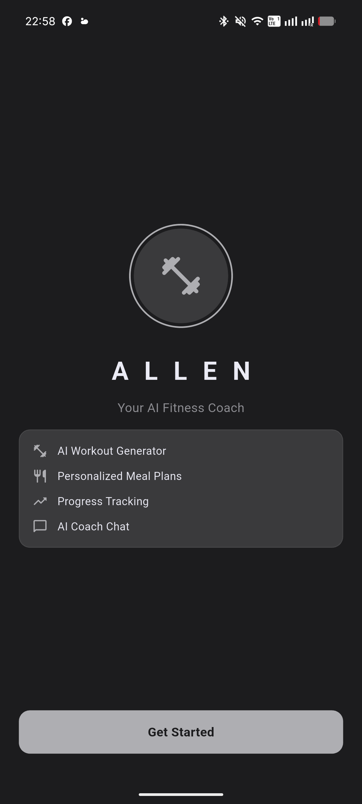

## The Problem

Fitness and nutrition guidance is usually generic, manual, and spread across several apps. People want a coach that understands them in plain language and gives personalized advice. Allen applies a large language model to make health guidance conversational and personal.

## What It Does

- **AI Coach (conversational NLP)** — chat naturally with a Gemini-powered coach that keeps context and stays focused on fitness and health.
- **Workout Generator** — pick muscle group, difficulty, and duration for a tailored plan.
- **Meal Planner** — goal, diet preference, and calorie target produce a full day of meals.
- **Calorie Scanner** — snap a food photo; Gemini Vision estimates calories and macros.
- **Meal & Water Tracking** — log meals against your daily calorie target and track water intake toward a hydration goal.
- **Progress Tracking** — dashboard overview plus weight trends, workout stats, and full workout history with charts.
- **Profile & BMI** — personal details, automatic BMI, and daily macro targets.
- **Auth** — email/password sign-up, login, session restore, password reset, and account deletion via Firebase.

## Screenshots

### Onboarding & Auth

| Sign in | Sign up |
| --- | --- |
| 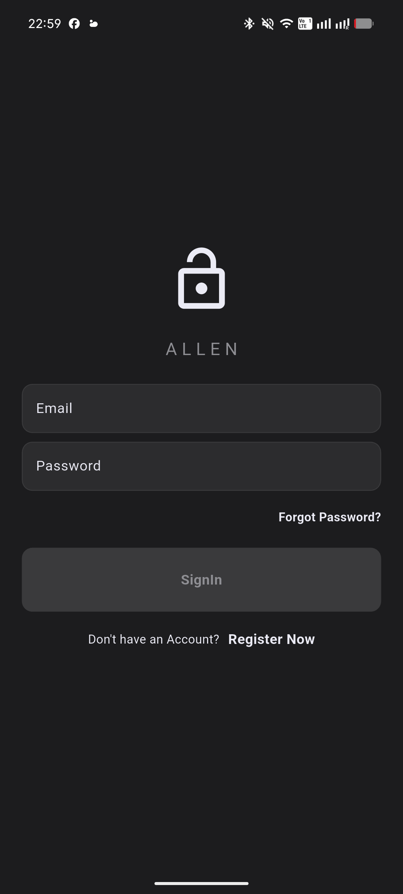 | 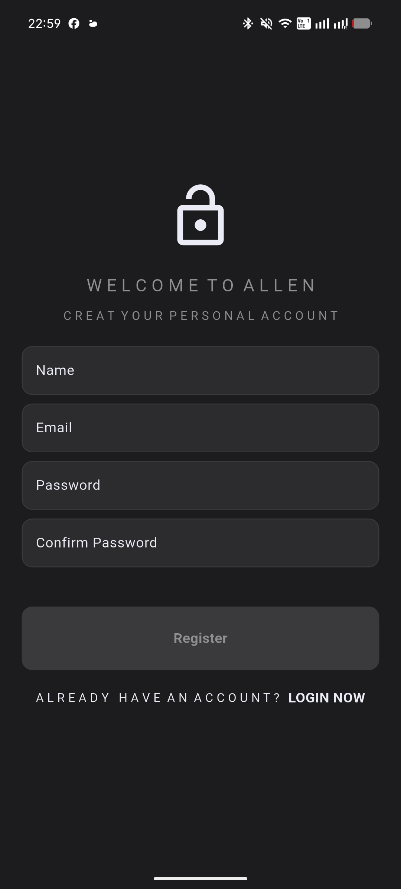 |

### Core experience

| Home | AI Coach | Workout generator |
| --- | --- | --- |
| 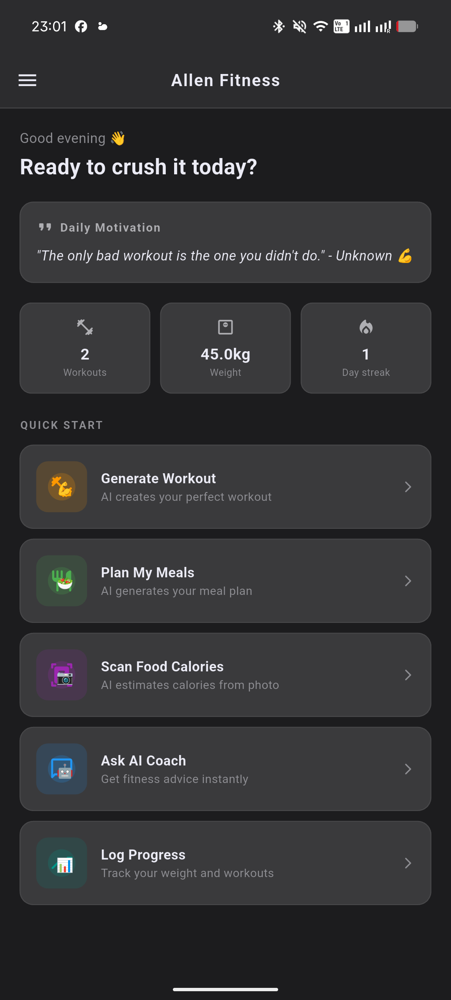 | 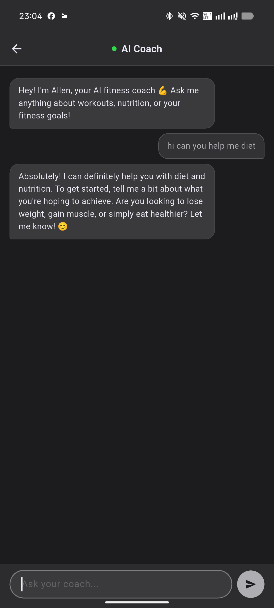 | 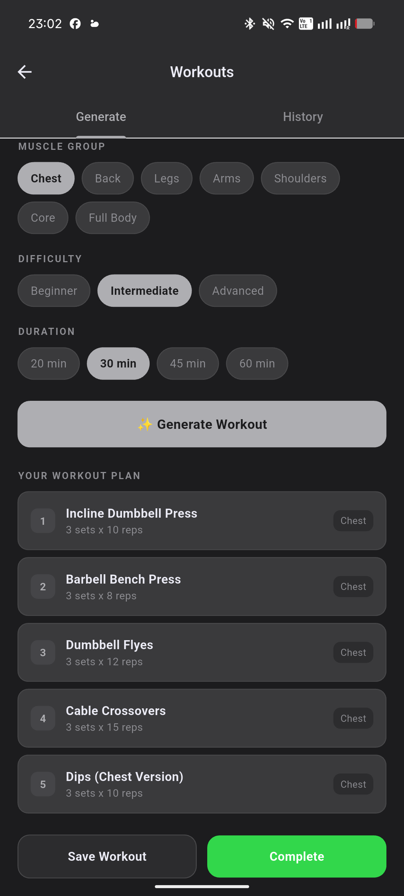 |

### Meal & food

| Meal planner | Calorie scanner | Meal tracker |
| --- | --- | --- |
| 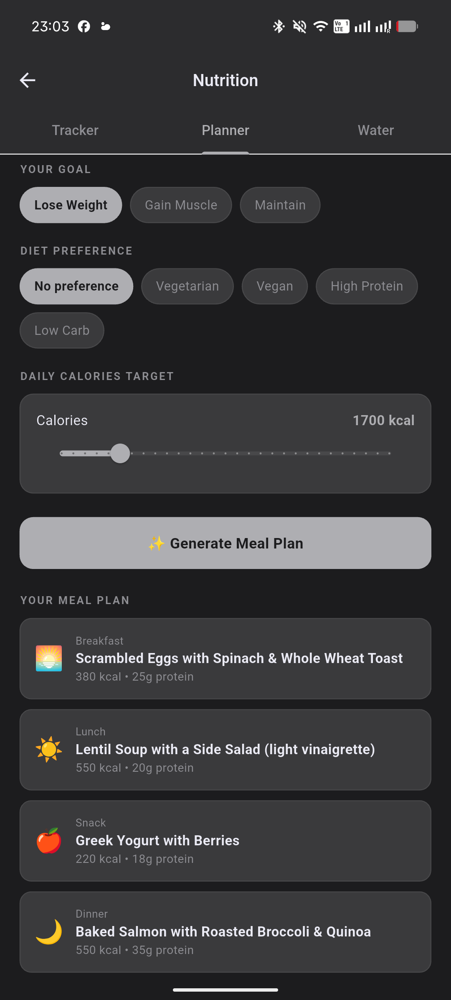 | 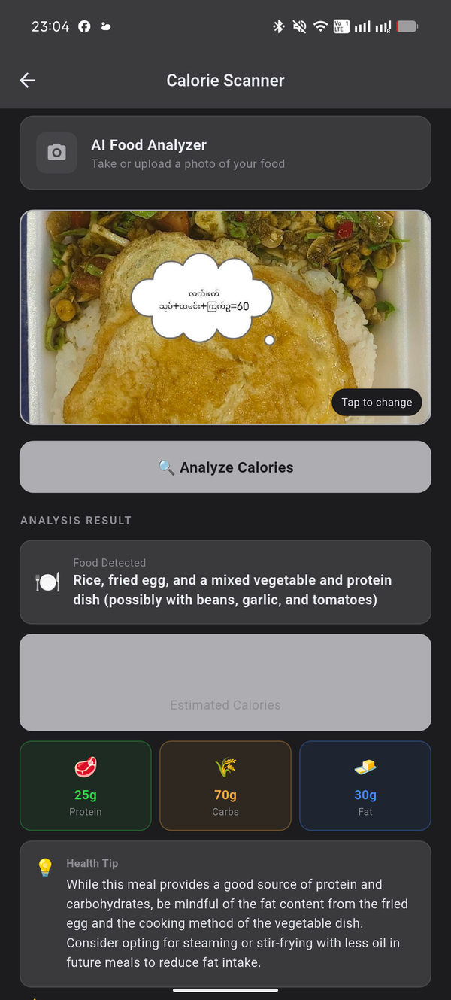 | 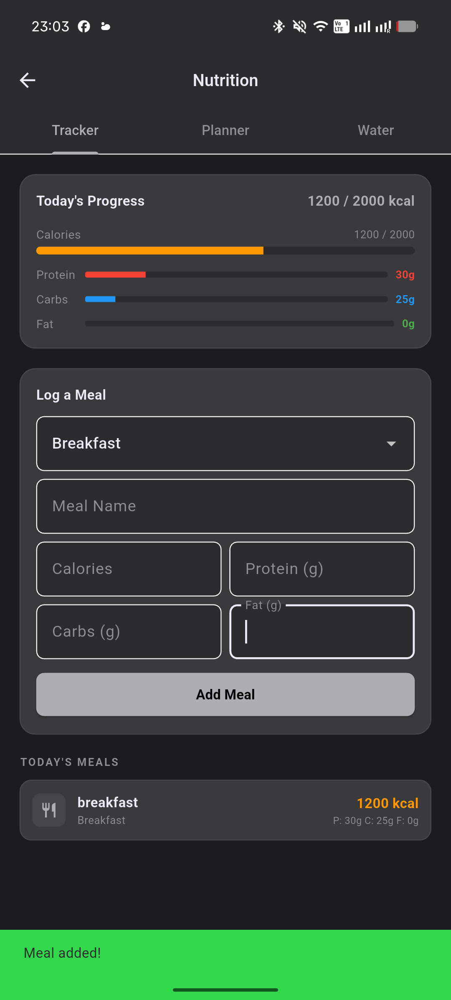 |

### Tracking

| Water tracker | Progress overview | Weight progress |
| --- | --- | --- |
| 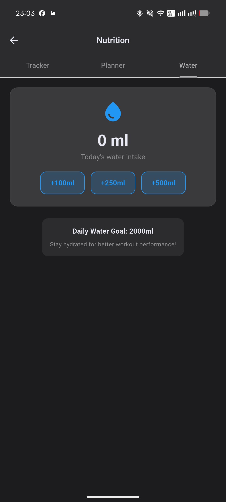 | 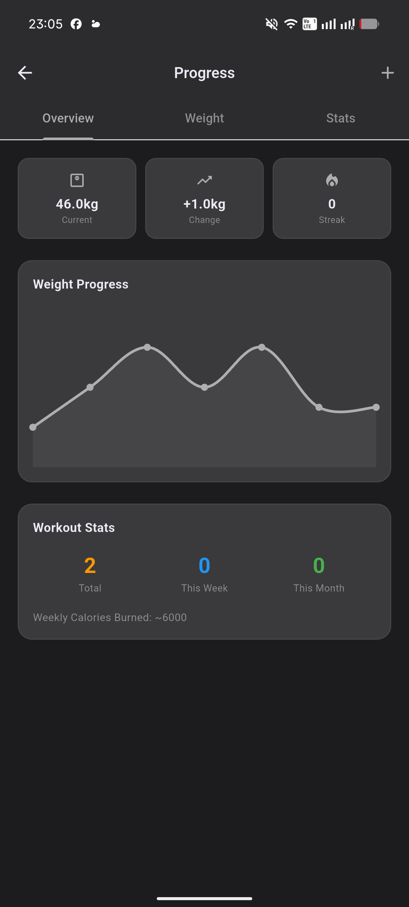 | 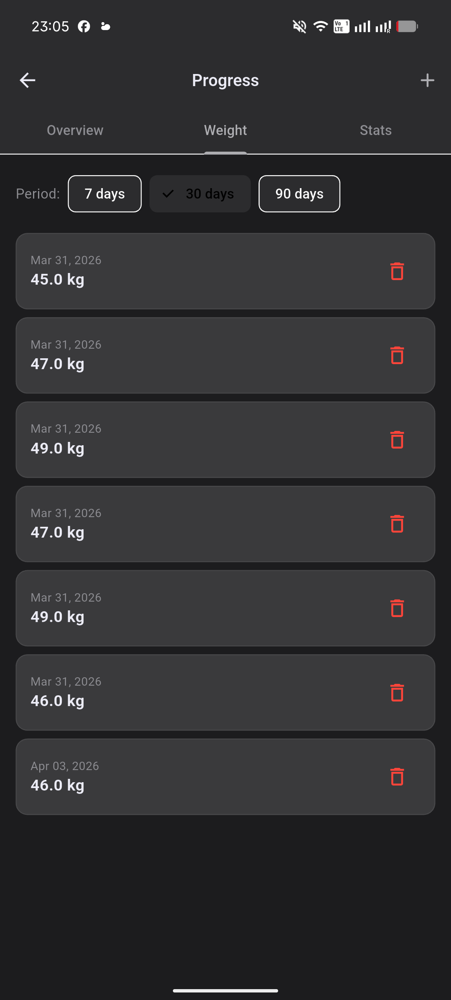 |

### Progress & profile

| Workout stats | Workout history | Profile & BMI |
| --- | --- | --- |
| 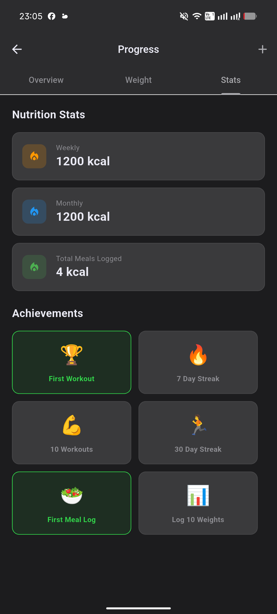 | 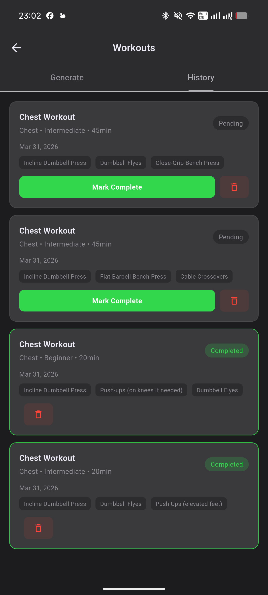 | 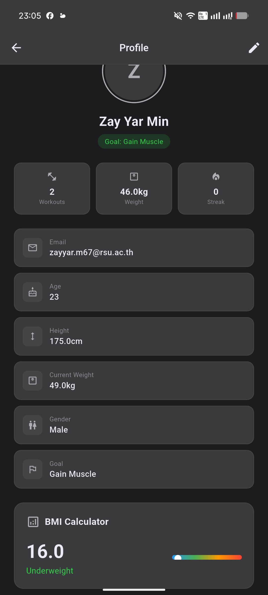 |

## Hackathon Alignment

The event challenged teams to build NLP models that help human lives. Allen adapts a state-of-the-art language model (**Google Gemini `gemini-2.5-flash-lite`**) into a natural-language health coach and food-image analyzer, turning conversational AI and vision into practical everyday wellness support.

## Tech Stack

| Area | Technology |
| --- | --- |
| Framework | Flutter (Dart 3+) |
| Authentication | Firebase Authentication |
| Database | Cloud Firestore |
| State management | flutter_bloc |
| NLP / AI | Google Gemini (`gemini-2.5-flash-lite`) via REST |
| Local storage | shared_preferences |
| Media / Charts / Notifications | image_picker, fl_chart, flutter_local_notifications |

## Architecture

- **Feature-first** structure: `lib/features/auth` (data / domain / presentation) and `lib/fitness` (models, pages, repositories, services, theme).
- **Repository pattern** with an abstract `AuthRepo` contract implemented by `FirebaseAuthRepo`, keeping Firebase details out of the UI.
- **Bloc/Cubit** for auth state, so the app reacts instantly to login/logout.
- **Service layer** (`AiService`, `StorageService`, `NotificationService`) isolates external APIs and device features.
- AI calls include **graceful fallbacks** so the app stays usable when the API hits rate limits or errors.

## My Contribution

I was responsible for the **authentication system and the AI/API integration layer**:

- Implemented `FirebaseAuthRepo` against an `AuthRepo` interface — email/password registration and login, session restoration, logout, password-reset email, and account deletion.
- Built the `AuthCubit`/`AuthState` flow on **flutter_bloc**, including loading and error states surfaced to the UI.
- Developed `AiService`, integrating **Google Gemini** for coach chat with history, workout generation, meal planning, food-photo calorie analysis (vision), and daily motivational quotes.
- Initialized **Firebase** at the app entry point and wired the auth-gate navigation (intro → auth → home).

## Getting Started

```bash
git clone https://github.com/Suboon-stack/Allen-Fitness-Coach.git
cd Allen-Fitness-Coach
flutter pub get
```

Configure Firebase (generates `lib/firebase_options.dart` and `android/app/google-services.json`):

```bash
dart pub global activate flutterfire_cli
flutterfire configure
```

Add your Gemini API key:

```bash
cp lib/secrets.example.dart lib/secrets.dart
# then set: const String geminiAPIKey = 'YOUR_GEMINI_API_KEY';
```

Run:

```bash
flutter run
```

## Security Note

`lib/secrets.dart`, `lib/firebase_options.dart`, and `android/app/google-services.json` contain credentials and are git-ignored. Only sanitized `*.example` versions are committed.

## License

Educational and portfolio use.
